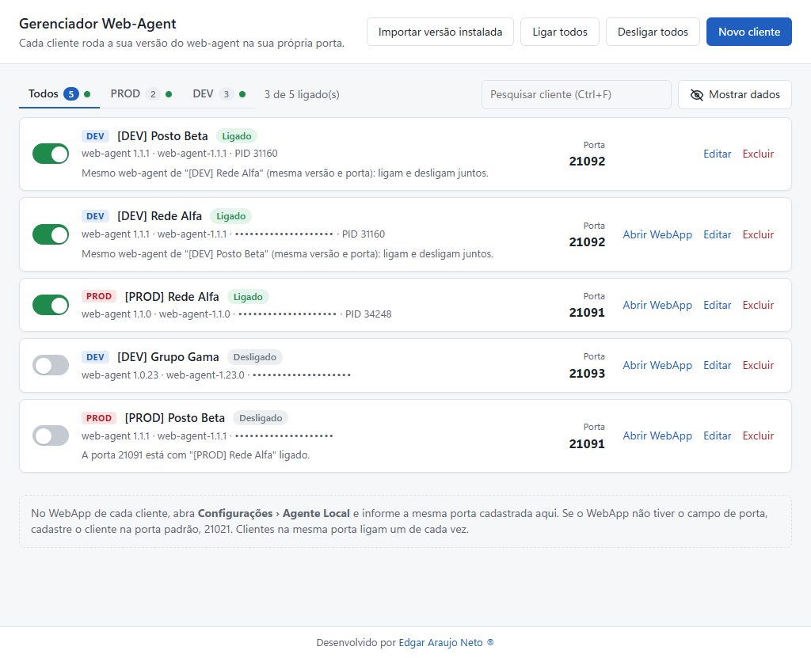

# Gerenciador Web-Agent

Rode várias versões do **TOTVS web-agent** ao mesmo tempo, uma para cada cliente, cada uma na sua porta. Ligue e desligue o agente de cada cliente com um clique, pela janela ou pelo ícone perto do relógio.

**[Baixar a versão mais recente](../../releases/latest)** · Windows 10 e 11, 64 bits · gratuito

> Projeto pessoal e independente, sem vínculo com a TOTVS.

## Sumário

- [Para que serve](#para-que-serve)
- [Recursos](#recursos)
- [Instalação](#instalação)
- [Primeiros passos](#primeiros-passos)
- [Uso no dia a dia](#uso-no-dia-a-dia)
- [Privacidade](#privacidade)
- [Solução de problemas](#solução-de-problemas)
- [Problemas e sugestões](#problemas-e-sugestões)
- [Autor](#autor)

## Para que serve

Cada cliente TOTVS pede a versão do web-agent que combina com o WebApp dele. O instalador do web-agent sobrescreve a versão anterior, e todas as versões disputam a mesma porta padrão, a 21021. Quem atende vários clientes acaba reinstalando o agente toda vez que troca de cliente.

O Gerenciador Web-Agent guarda cada versão numa pasta própria e abre cada uma na porta do cliente. Várias versões rodam juntas, sem reinstalar nada.

## Recursos

- **Uma versão por cliente:** cada cliente tem a sua pasta do web-agent e a sua porta.
- **Liga e desliga com um clique:** uma chave por cliente, mais "Ligar todos" e "Desligar todos".
- **Clientes na mesma porta:** para WebApps que só procuram o agente na 21021. O gerenciador liga um de cada vez e pede confirmação antes de trocar.
- **Abas PROD e DEV:** separam os ambientes. "Ligar todos" e "Desligar todos" valem só para a aba aberta.
- **Busca por nome:** sem diferença de maiúsculas e acentos. Atalho Ctrl+F.
- **URL oculta:** a URL do WebApp começa escondida, para não aparecer num compartilhamento de tela.
- **Ligados no topo:** a lista mostra primeiro os clientes ligados.
- **Bandeja do Windows:** o gerenciador fica perto do relógio. Pelo menu do ícone, você liga e desliga clientes sem abrir a janela.
- **Iniciar com o Windows:** o gerenciador abre direto na bandeja e liga os clientes marcados.
- **Detecção de agentes de fora:** o gerenciador reconhece um web-agent aberto pela instalação padrão ou por um atalho antigo e oferece encerrá-lo.
- **Aviso quando um agente para sozinho:** notificação do Windows. Se o agente falhar logo ao ligar, o gerenciador tenta mais uma vez antes de avisar.

## Instalação

### Requisitos

- Windows 10 ou 11, 64 bits.
- Pelo menos uma versão do web-agent já instalada pelo WebApp de um cliente.

### Instalar

1. Na página [Releases](../../releases/latest), baixe o arquivo `Gerenciador-Web-Agent-Setup-<versão>.exe`.
2. Execute o arquivo. A instalação não pede administrador. Ela cria os atalhos na área de trabalho e no menu Iniciar e abre o gerenciador.
3. O executável não tem assinatura digital. Se o Windows mostrar "O Windows protegeu o computador", clique em **Mais informações** e depois em **Executar assim mesmo**.

O programa fica em `%LOCALAPPDATA%\Programs\webagent-manager`.

### Atualizar e desinstalar

- **Atualizar:** baixe a versão nova e execute o instalador por cima. O cadastro dos clientes continua.
- **Desinstalar:** use **Configurações › Aplicativos** do Windows. O cadastro dos clientes fica guardado para uma futura instalação.

## Primeiros passos

1. Instale o web-agent do cliente pelo link do WebApp dele, como sempre.
2. No gerenciador, clique em **Importar versão instalada**. A instalação atual é copiada para `%LOCALAPPDATA%\Programs\web-agent-<versão>`. A próxima instalação do web-agent não apaga essa cópia.
3. Repita os passos 1 e 2 para cada versão de que você precisa.
4. Clique em **Novo cliente**. Informe o nome, o ambiente (PROD ou DEV), a URL do WebApp (opcional), a versão e a porta. O gerenciador sugere portas livres a partir da 21022.
5. No WebApp do cliente, abra **Configurações › Agente Local** e informe a mesma porta.
6. Ligue o cliente pela chave da lista.

Na primeira execução, o gerenciador transforma em clientes os atalhos `.lnk` que encontrar dentro das pastas `web-agent*`, cada um numa porta nova.

## Uso no dia a dia

### Clientes na mesma porta

Alguns WebApps não têm o campo de porta e só procuram o agente na 21021. Por isso, vários clientes podem ficar cadastrados na mesma porta.

| Situação | O que acontece |
|---|---|
| Versões diferentes na mesma porta | Só um cliente liga por vez. Ao ligar o segundo, o gerenciador pergunta se pode desligar o primeiro. "Ligar todos" liga o primeiro da lista e avisa quais ficaram desligados. |
| Mesma versão na mesma porta | Os clientes usam o mesmo processo do web-agent. Eles ligam e desligam juntos, e a tela mostra isso. |
| Porta com um web-agent aberto fora do gerenciador | O gerenciador oferece encerrar esse processo antes de ligar. |
| Porta com outro programa | O gerenciador não encerra o programa. Troque a porta do cliente. |

### Abas, busca e dados ocultos

- As abas **Todos**, **PROD** e **DEV** filtram a lista. Um ponto verde na aba indica cliente ligado nela.
- Cadastro antigo, sem ambiente, ganha um pelo nome. "PROD" ou "Produção" no nome vai para PROD. "DEV", "HML", "homologação" ou "teste" vai para DEV. O resto vai para PROD.
- A lista mostra primeiro os ligados, depois os que pararam sozinhos e depois o resto. Dentro de cada grupo, a ordem é alfabética.
- A busca filtra pelo nome. Ctrl+F leva à busca; Esc limpa.
- O botão **Mostrar dados** exibe a URL dos clientes. A URL volta a ficar oculta toda vez que o gerenciador abre. No formulário, a URL só aparece quando o campo recebe o foco.

### Bandeja do Windows

Fechar a janela só a esconde. O gerenciador continua no ícone perto do relógio.

- **Clique** no ícone para abrir a janela.
- **Clique com o botão direito** para ver o menu. Os clientes ligados aparecem no topo. A lista completa fica nos submenus **PROD** e **DEV**, para o menu não crescer com muitos clientes. Marcar ou desmarcar um cliente liga ou desliga o agente dele.
- O ícone ganha um **ponto verde** quando algum agente está ligado.
- **Iniciar com o Windows** abre o gerenciador direto na bandeja quando o Windows inicia. Os clientes marcados com "Ligar quando abrir o gerenciador" sobem sozinhos.
- **Sair** fecha o gerenciador. Os agentes continuam rodando. Ao reabrir, o gerenciador reconhece cada agente pelo executável e pela porta.

### O que cada situação significa

| Situação | Significado |
|---|---|
| Ligado | O web-agent do cliente está escutando na porta do cliente. |
| Ligado por fora | Um web-agent da mesma versão, aberto fora do gerenciador, está na porta do cliente. Ele atende o cliente normalmente. |
| Ligando… | O processo abriu, mas a porta ainda não abriu. |
| Porta ocupada | Outro web-agent, aberto fora do gerenciador, ou outro programa usa a porta. O texto diz qual. |
| Desligado, "a porta está com…" | Outro cliente cadastrado na mesma porta está ligado. |
| Parou sozinho | O agente fechou sem ninguém desligar. O Windows também mostra um aviso. |
| Rodando sem abrir a porta | O processo continua aberto, mas a porta não abriu nem depois de uma nova tentativa. |

A seção **Outros web-agents rodando** lista os agentes abertos fora do gerenciador: a instalação padrão, atalhos antigos ou a inicialização do Windows. Você pode encerrar cada um por ali.

## Privacidade

- O cadastro fica só no seu computador, em `%APPDATA%\Gerenciador Web-Agent\clientes.json`.
- O gerenciador não envia dados para nenhum servidor.
- O gerenciador não faz requisições ao web-agent. Ele só consulta os processos e as portas do Windows.

## Solução de problemas

**O ícone sumiu da bandeja.**
O Windows 11 esconde ícones novos na seta **^** da barra de tarefas. Arraste o ícone para a barra, ou ligue-o em **Configurações › Personalização › Barra de tarefas › Outros ícones da bandeja**.

**O cliente fica em "Porta ocupada".**
Leia o texto do cartão. Se a porta estiver com um web-agent de fora, ligue o cliente e confirme **Encerrar e ligar**. Se estiver com outro programa, cadastre o cliente em outra porta e informe essa porta no WebApp.

**O agente para sozinho logo depois de ligar.**
O gerenciador já tenta de novo uma vez. Se o problema continuar, [abra uma issue](../../issues/new/choose) com a versão do web-agent.

**A versão mostrada não bate com o nome da pasta.**
O gerenciador lê a versão real do web-agent, gravada dentro da pasta. Uma pasta `web-agent-1.23.0`, por exemplo, pode conter a versão 1.0.23.

**O WebApp não tem o campo de porta.**
Cadastre o cliente na porta padrão, 21021. Veja [Clientes na mesma porta](#clientes-na-mesma-porta).

## Problemas e sugestões

Encontrou um problema ou tem uma ideia? [Abra uma issue](../../issues/new/choose) e escolha **Problema** ou **Sugestão**.

O link **Página do projeto**, no rodapé do gerenciador, abre esta página. Por ela você também acompanha as versões novas.

Não coloque na issue URLs, nomes de clientes ou prints com dados de clientes.

## Autor

Desenvolvido por [Edgar Araujo Neto](https://www.linkedin.com/in/edgar-ara%C3%BAjo-8b711a143).
